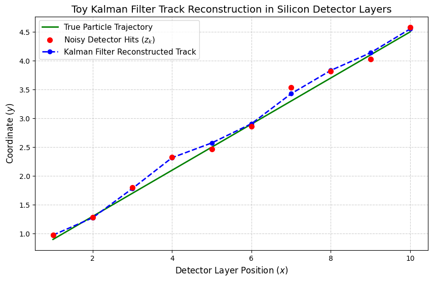

# cern-kalman-filter-tracker
# Toy Kalman Filter for Charged Particle Track Reconstruction

A Python-based simulation and iterative tracking algorithm designed to reconstruct charged particle trajectories through noisy multi-layer silicon detector planes.

## Project Overview
* **Algorithm:** Linear Kalman Filter (Prediction & Update steps)
* **Libraries Used:** NumPy, Matplotlib
* **Physics Goal:** Filter out spatial measurement noise and estimate optimal particle states (position and trajectory slope) across simulated detector layers.

## Key Results
The Kalman filter successfully separates erratic detector hit noise (red points) and locks onto the true particle trajectory (blue dashed line).

